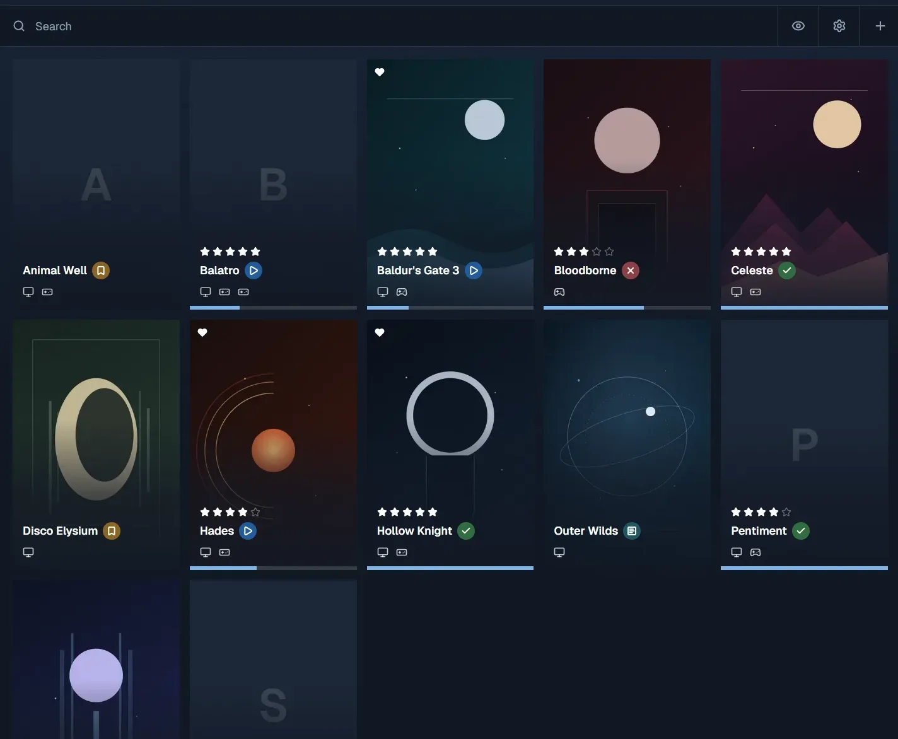

# Deckside

[](LICENSE)

Deckside is a personal game library: track what you own, what is up next, what
you are playing, and what you have finished. Built with Next.js 16, SQLite, and
Drizzle ORM.

[Live demo](https://deckside-demo.glasspile.com/) · [Demo branch](https://github.com/jukrapopk/deckside/tree/demo)

[](https://deckside-demo.glasspile.com/)

*The demo library, seeded with sample games and original posters.*

## Run locally

```bash
npm install
npm run db:seed   # optional: sample games
npm run dev
```

Open [http://localhost:3000](http://localhost:3000). The SQLite database is
created at `data/game-library.db`, and migrations run when the server starts.

Deckside has no authentication. Keep it on localhost or a trusted private
network.

## Demo

The [live demo](https://deckside-demo.glasspile.com/) runs from the
[`demo` branch](https://github.com/jukrapopk/deckside/tree/demo). It uses the
same interface without SQLite: sample games and changes live in `localStorage`,
so each browser gets its own copy. Some sample games use eight original abstract
posters. A cover you upload is resized in the browser and stored with the game,
so it counts against the browser's storage. The Vercel project sets `DEMO_MODE=1`
so `/` serves the demo. It needs no database or SteamGridDB key, and live cover
search is disabled.

`main` remains the full local app backed by SQLite.

## Scripts

| Script | What it does |
| --- | --- |
| `npm run dev` | Development server with hot reload |
| `npm run build` | Production build |
| `npm run start` | Serve the production build |
| `npm run lint` | ESLint |
| `npm run typecheck` | Generate route types and type-check |
| `npm run db:generate` | Generate a migration after editing the schema |
| `npm run db:migrate` | Apply pending migrations |
| `npm run db:seed` | Replace contents with sample data |
| `npm run db:studio` | Browse the database in Drizzle Studio |

## Configuration

| Variable | Default | Purpose |
| --- | --- | --- |
| `DATABASE_PATH` | `./data/game-library.db` | SQLite file location |
| `MIGRATIONS_PATH` | `./drizzle` | Directory migrations are read from |
| `STEAMGRIDDB_API_KEY` | unset | Overrides the key saved in Settings |
| `ALLOWED_DEV_ORIGINS` | unset | Extra dev hosts, comma-separated (LAN/Tailscale) |

Copy `.env.example` to `.env.local` for local Next development. Covers come from
SteamGridDB or from a file you upload; either way the image is downloaded (if
needed) and stored as a WebP next to the database, in `data/covers`, so the
library keeps its own copy. Searching uses SteamGridDB — add a key in Settings or
set `STEAMGRIDDB_API_KEY`; searches run on the server, so the browser never
receives the key.

## Docker

A `Dockerfile` and `docker-compose.yml` are included.

```bash
docker compose up --build
```

The image runs as a non-root user and stores `/data/deckside.db` and uploaded
covers in `/data/covers` on the `deckside_data` volume. Compose publishes on `127.0.0.1:3210` by default; open
[http://localhost:3210](http://localhost:3210). Set `HOST_PORT` to use another
port, and `BIND_ADDRESS` to reach it over a private network. For example,
`BIND_ADDRESS=0.0.0.0` listens on every interface (including Tailscale/LAN). Set
`BUILD_STANDALONE=1` for the standalone build the Dockerfile expects.

## License

MIT. See [LICENSE](LICENSE).
